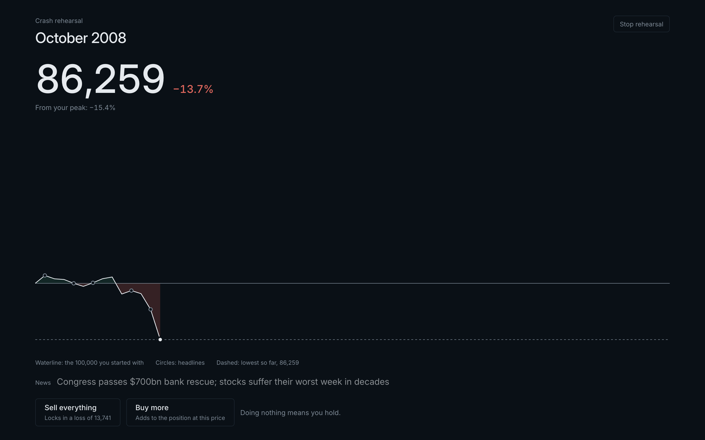
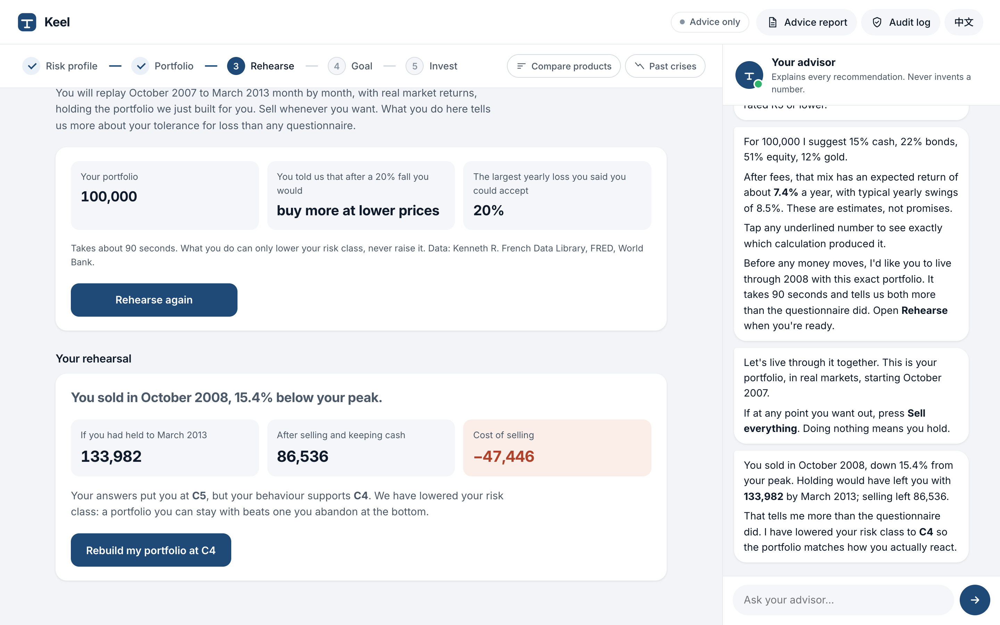
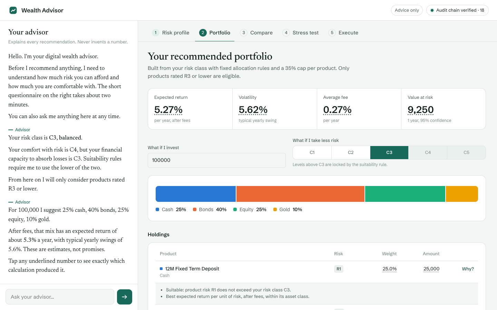
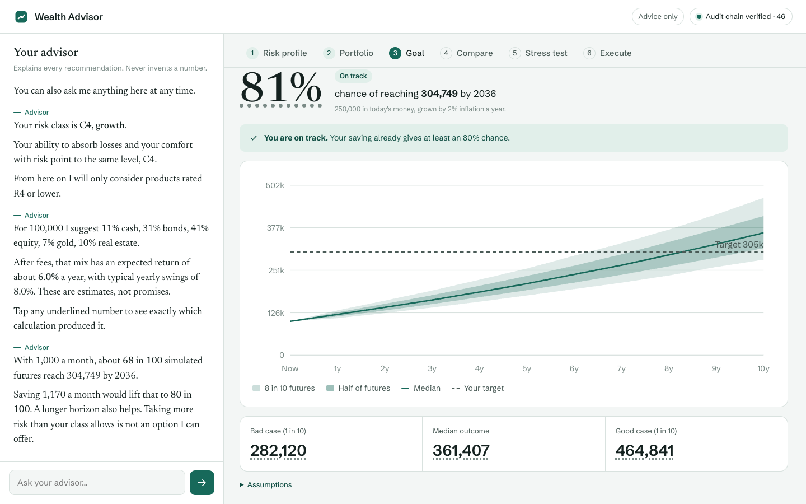
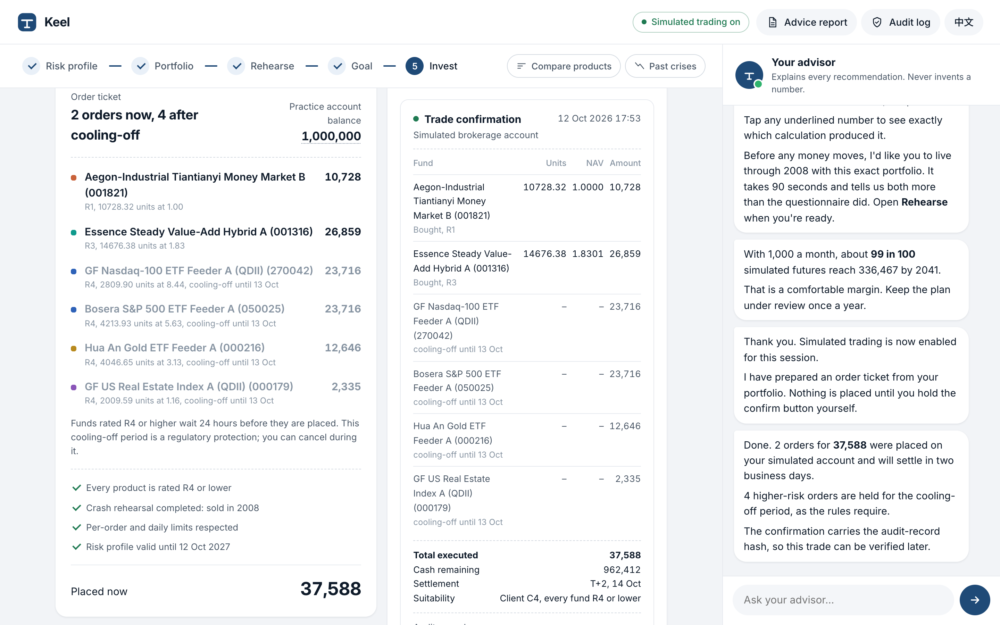

# Keel — the AI wealth advisor that keeps you steady, and proves its advice

**FinTechathon 2026 · International Track · Topic B: Wealth Advisory Agent**

Keel runs the workflow of a licensed wealth advisor — fact-find, risk profiling, product
comparison, asset allocation, stress testing and client-confirmed execution — in a natural
conversation. Two things make it different.

**1. Crash Rehearsal — it stress-tests the investor, not just the portfolio.** Before any money
moves, the client lives through October 2007 – March 2013 with the exact portfolio we recommend,
month by month on real market data (Kenneth R. French Data Library, FRED, World Bank), with the
headlines of the time and a *Sell everything* button. Where they actually sell reveals their risk
tolerance far better than a questionnaire answer. Revealed tolerance can only lower the risk class,
never raise it, and the result goes into the audit log and the client's Advice Report.





**2. Every recommendation can be checked:**

- **Every number comes from audited code, never from the model.** Tap any figure in the UI to see
  the function that computed it and the audit record it was written to.
- **Real products.** 24 real Chinese public mutual funds (money market, bond, index, QDII, gold)
  built from open East Money data, with distributor risk levels R1–R5, real fees and NAV history.
- **Suitability is enforced by the server.** Risk class C1–C5 against product risk R1–R5, modelled
  on CSRC investor-suitability rules. The model can neither raise a client's class nor recommend a product above it.
- **Only the client can move money.** Orders need a signed risk disclosure and a hold-to-confirm
  with a one-time token the model can never obtain.
- **Every decision is on a tamper-evident record.** A hash-chained audit log, a fingerprinted
  Advice Report, and the chain head written to an `AuditAnchor` smart contract on
  **FISCO BCOS**, the open-source consortium blockchain led by WeBank.



| Goal planning | Hold-to-confirm execution and trade confirmation |
|---|---|
|  |  |

## Topic B requirements

| Requirement | Where |
|---|---|
| Professional advisory workflow and dialogue | Agent loop with stage-aware tools and an advisor workflow prompt (`agent.py`, `prompts.py`, `session.py`); chat and client file stay in sync |
| Client risk profiling | Capacity vs tolerance questionnaire → C1–C5 with reason codes and client-protection caps (`profiling.py`) |
| Product comparison | Suitable products ranked by return per unit of risk after fees, with fee cost over the client's horizon (`catalog.py`) |
| Compliant, explainable allocation | Strategic weights per class, suitability and liquidity constraints, product caps, reason codes per holding (`allocation.py`, `compliance.py`) |
| Beyond the brief | **Crash Rehearsal** (behavioural risk profiling, `rehearsal.py`), Monte Carlo goal planning, historical stress tests against the client's own loss limit, Advice Report, simulated execution |

## Quick start

Requirements: Python 3.12 and [uv](https://docs.astral.sh/uv/).

```bash
uv sync
cp .env.example .env          # add GROQ_API_KEY (free at console.groq.com) for the live advisor
LLM_MODE=live uv run wealth-advisor-ui
# open http://127.0.0.1:8600
```

Without a key everything except free-form chat works offline: `uv run wealth-advisor-ui` uses
replay mode, and the questionnaire, portfolio, goal, comparison, stress test, execution and report
steps are all deterministic.

### Deploy to Vercel

The production app is [keel-eight-mu.vercel.app](https://keel-eight-mu.vercel.app). The requested
`keel.vercel.app` name was unavailable, so Vercel assigned this project URL. It uses Vercel's Python runtime
with `api/index.py` exporting the FastAPI app. Configure the production environment once, using
product Groq keys only (never `GROQ_EVAL_API_KEY`):

```bash
vercel link
vercel env add GROQ_API_KEY production
vercel env add GROQ_API_KEYS production
vercel env add STATE_COOKIE_SECRET production
vercel env add LLM_MODE production            # live
vercel env add LIVE_MARKET production         # 1
vercel env add WEALTH_ADVISOR_CATALOG production  # cn
vercel env add AUDIT_LOG production           # /tmp/keel-audit.jsonl
vercel env add ANCHOR_NETWORK production      # sepolia
vercel --prod
```

Vercel instances use an authenticated state cookie so the profile, portfolio, crash test, goal and
invest steps survive cold starts; the audit log is ephemeral under `/tmp`. Without a configured
Sepolia key, the anchor endpoint reports a clear unavailable error rather than contacting the local
FISCO BCOS chain.

Other entry points:

```bash
LLM_MODE=live uv run wealth-advisor chat     # terminal conversation
uv run wealth-advisor demo                   # scripted end-to-end run
uv run wealth-advisor --verify-audit         # recompute the audit hash chain
uv run python scripts/smoke_live.py          # one short live journey
```

Blockchain anchoring on FISCO BCOS (local 4-node consortium chain, macOS or Linux):

```bash
scripts/fisco_chain.sh start      # downloads FISCO BCOS 3.17 once, starts 4 nodes, Web3 RPC on :8545
```

The web app anchors there by default. `ANCHOR_NETWORK=sepolia` plus a `SEPOLIA_PRIVATE_KEY`
uses the public Ethereum testnet instead.

## Tests and evaluations

```bash
uv run pytest                                          # unit, API and red-team regression tests (offline)
uv run python evals/redteam/run.py                     # 65-case red-team suite → evals/redteam/REPORT.md
LLM_MODE=live uv run python evals/journeys/run.py      # 30 client personas on the live model → evals/journeys/REPORT.md
```

| Evaluation | Result |
|---|---|
| Red-team, attacks stopped | 57 / 57 |
| Red-team, benign requests handled correctly | 8 / 8 |
| Client journeys completed on the live model | **29 / 30** (97%; 30 personas across C1–C5, 6 in Chinese; profile class correct 29/30, suitable allocation 30/30) |

## Submission checklist

| Rules item | In this repository |
|---|---|
| 1. Technical documentation (architecture, core algorithms, security design) | [`submission/Keel_Technical_Documentation.pdf`](submission/Keel_Technical_Documentation.pdf), built from the docs below by `scripts/build_docs_pdf.py` |
| 2. Presentation deck | `submission/` (final deck) |
| 3. Demo video | [`submission/Keel_Demo.mp4`](submission/Keel_Demo.mp4), recorded end to end by `scripts/record_demo.py` |
| 4. Source code, README, deployment, tests | this repository; Quick start above; `tests/`, `evals/`; `Dockerfile`; CI in `.github/workflows/ci.yml` |
| 5. Security self-assessment | [`submission/Keel_Security_Self_Assessment.pdf`](submission/Keel_Security_Self_Assessment.pdf) |
| 6. Execution evidence | [`evidence/`](evidence/INDEX.md): simulated-account sessions with hash-chained audit logs and FISCO BCOS transaction hashes |

## Documentation

- [Architecture](docs/ARCHITECTURE.md) — components, the model/code boundary, one chat turn, data model, permission tiers
- [Core algorithms](docs/ALGORITHM.md) — risk profiling, Crash Rehearsal, real-fund universe, allocation, stress tests, market estimates and backtest, goal Monte Carlo
- [Security self-assessment](docs/SECURITY_SELF_ASSESSMENT.md) — threat model, permission-tier implementation, controls ↔ tests, red-team results, known risks
- [Roadmap](docs/ROADMAP.md)
- [Third-party software, data and fonts](THIRD_PARTY_NOTICES.md) — licenses and data terms

## Stack

Python 3.12 · FastAPI · NumPy · FISCO BCOS 3.17 + Solidity · Groq (OpenAI-compatible API: `openai/gpt-oss-120b`, fallbacks
`qwen/qwen3.8-27b`, `openai/gpt-oss-20b`; `llama-prompt-guard-2-86m` for injection scoring) ·
web3.py · plain HTML/CSS/JS front end with English and 简体中文, no build step.

## Disclaimer

A competition prototype. Fund data is public information on real funds and may be out of date;
orders run on a simulated brokerage account. It is not investment advice.
