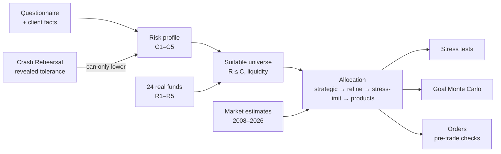

# Core algorithms

Everything on this page is deterministic Python with unit tests. The language model never computes
any of these numbers; it calls the functions below as tools and explains their outputs.

## 1. Risk profiling (`profiling.py`)

The investor class is the lower of two independent scores, following the CSRC investor-suitability
principle that a client must both be able to bear a loss and be willing to.

| Question | Measures | Points per option (low → high risk) |
|---|---|---|
| Investment horizon | capacity | <1y 0 · 1–3y 1 · 3–7y 2 · 7–10y 3 · >10y 4 |
| When money may be needed | capacity | any day 0 · within a week 1 · within a month 2 · not for a month+ 4 |
| Income stability | capacity | irregular 0 · partly stable 1 · stable 2 |
| Emergency fund | capacity | none 0 · 3–6 months 2 · >6 months 4 |
| Share of net worth | capacity | >75% 0 · 50–75% 1 · 25–50% 2 · <25% 4 |
| Reaction to a 20% fall | tolerance | sell all 0 · reduce 1 · hold 3 · buy more 4 |
| Experience | tolerance | none 0 · basic 1 · good 3 · advanced 4 |
| Goal | tolerance | preserve 0 · income 1 · growth 3 · maximum growth 4 |

- Score → class: ≤2 C1, ≤5 C2, ≤8 C3, ≤11 C4, otherwise C5 (same thresholds for both scores).
- **Investor class = min(capacity class, tolerance class).**
- Client-protection caps: age 70+, no emergency fund or borrowed money → at most C2; horizon under
  one year → C1. Each cap adds a flag and the reason code `VULNERABILITY_CAP_APPLIED`.
- The liquidity answer becomes `liquidity_days` (1, 7, 30, 365) and drives the liquidity sleeve.
- Every answer becomes a reason code (`HORIZON_3_7Y`, …), shown to the client as "Why this class".
- Profiles expire after 12 months; execution is refused on an expired profile.

## 2. Revealed risk tolerance: Crash Rehearsal (`rehearsal.py`)

Questionnaires record what clients *say*. Before any money moves, the client replays
October 2007 – March 2013, month by month, holding exactly the recommended mix, and may sell at any
point.

- **Data:** monthly total returns per asset class, built by `scripts/build_rehearsal_data.py` —
  equity and cash from the Kenneth R. French Data Library (Fama/French 3 factors, `Mkt-RF + RF`,
  `RF`), real estate from French's 49-industry `RlEst` portfolio, bonds from FRED `GS10` with a
  duration-6 price approximation (`r = y₋₁/12 − 6·Δy`), gold from World Bank commodity prices.
  US markets serve as the proxy for global markets (US equity: −49% peak to trough in Feb 2009).
- **Path:** buy-and-hold value of each asset-class sleeve; drawdown measured from the running peak.
- **Decision:** selling moves the whole portfolio to cash (earning the T-bill return) from that
  month on. The outcome reports the value at March 2013 if held vs. after the client's choice.
- **Revealed class** from the drawdown at the moment of selling: <5% C1, <10% C2, <15% C3,
  <25% C4, otherwise C5.
- **New class = min(previous class, revealed class).** Holding or buying more never raises the
  class, so behaviour can only make advice safer. The reason code `REVEALED_TOLERANCE_Cn` is added
  to the profile and the decision is written to the audit chain and the Advice Report.

## 3. Product universe (`scripts/build_cn_catalog.py`)

The web app advises on **24 real Chinese public mutual funds** (money market, bond, bond-plus and
balanced, CSI 300 / CSI 500 / dividend low-volatility, Hang Seng, S&P 500, Nasdaq-100, gold,
US real estate) built from open East Money / Tiantian Fund data — the source the open-source
AkShare library uses.

| Field | How it is derived |
|---|---|
| Risk level R1–R5 | Distributor label on the fund page: 低风险 R1, 中低风险 R2, 中风险 R3, 中高风险 R4, 高风险 R5 (money funds R1 by regulation) |
| Ongoing fee | Management + custody + sales-service fee from the fund's fee page |
| Volatility | Annualised standard deviation of 10 years of monthly accumulated-NAV log returns |
| Expected return | 50% historical CAGR (gross of fees) + 50% asset-class prior (cash 1.5%, bonds 3%, equity 7%, gold 4.5%, real estate 6%); a single fund's past return is a poor forecast |
| Money funds | 1-year average 7-day yield (quoted after fees, so the fee is added back before the engine nets it) |
| Liquidity days | By type: money funds 1, ultra-short bond 2, domestic funds 3, Hong Kong 4, QDII 10 |

Tests use a small deterministic mock catalog (`data/products.json`); `WEALTH_ADVISOR_CATALOG=cn`
selects the real one.

## 4. Asset allocation (`allocation.py`)

**Step 1 — strategic weights by class.**

| Class | Cash | Bonds | Equity | Gold | Real estate | Volatility band |
|---|---:|---:|---:|---:|---:|---|
| C1 | 45% | 45% | 5% | 5% | 0% | 0–6% |
| C2 | 30% | 45% | 10% | 10% | 5% | 2–9% |
| C3 | 15% | 40% | 25% | 10% | 10% | 4–14% |
| C4 | 10% | 30% | 40% | 10% | 10% | 6–20% |
| C5 | 5% | 20% | 55% | 10% | 10% | 8–28% |

Equity is additionally capped at 10/20/35/50/60% for C1–C5.

**Step 2 — suitable universe.** Keep products with risk level ≤ the client's class, minimum
investment ≤ amount, and not excluded by the client. If an asset class has no suitable product
(for example, real Chinese equity funds are all labelled R4, so a C3 client has none), its weight
is redistributed across the remaining classes in proportion to their strategic weights.

**Step 3 — liquidity sleeve.** A client who may need money within 1 / 7 / 30 days must hold at
least 30% / 20% / 10% in products redeemable within that time; lock-up products are allowed only
when the money is not needed for over a month.

**Step 4 — mean-variance refinement.** Within ±10 percentage points of the strategic weights
(cash ≥ 5%, equity ≤ the class cap) a projected-gradient ascent maximises

  `score(w) = wᵀμ − 0.75·wᵀΣw − 4·(distance of portfolio volatility outside the class band)²`

where μ and Σ come from market estimates (section 6) when supplied, or from the eligible products
and the asset-class correlation matrix otherwise. An optional Black-Litterman step anchors the
prior on the strategic weights. Weights stay on the simplex; at most 40 iterations.

**Step 5 — the client's own loss limit.** If the worst loss across the three historical stress
scenarios exceeds the largest yearly loss the client said they could accept, weight moves from real
estate and equity to cash and bonds (within ±10 pp of strategic) until it fits; if it still does
not, the next lower class is used. The allocation carries `STRESS_LIMIT_APPLIED` and the worst loss
before and after, shown to the client.

**Step 6 — product selection.** Within each asset class, products are ranked by
`(expected return − fee − cash rate) / volatility`, then fee, then id. The class weight is split
equally across the fewest top products that respect the 35% single-product cap (50% for R1 money
funds inside a liquidity sleeve) and each product's minimum investment. Every holding carries
reason codes (`SUITABLE_C3_R2`, `RISK_ADJUSTED_RETURN_NET_OF_FEES`, `LIQUIDITY_SLEEVE`, …).

**Portfolio statistics.** Expected return = Σ wᵢ(μᵢ − feeᵢ); volatility = √(wᵀΣw) with
Σᵢⱼ = ρ(classᵢ, classⱼ)·σᵢσⱼ; weighted fee; one-year 95% value at risk = 1.645 · σ · amount
(parametric, zero mean).

## 5. Stress tests (`stress.py`)

Asset-class shocks applied to the portfolio weights; the loss is compared with the client's stated
limit and a breach is flagged.

| Scenario | Cash | Bonds | Equity | Gold | Real estate |
|---|---:|---:|---:|---:|---:|
| 2008 global financial crisis | 0% | −8% | −37% | +5% | −40% |
| 2020 pandemic crash | 0% | +2% | −34% | −3% | −30% |
| 2022 rate shock | 0% | −13% | −18% | −1% | −20% |

## 6. Market estimates and backtest (`market.py`)

Monthly asset-class returns January 2008 – August 2026 (224 months; Kenneth R. French, FRED, World
Bank; `scripts/build_market_data.py`, sources in `data/market/SOURCES.md`).

- **Covariance:** Ledoit-Wolf shrinkage of the sample covariance towards its diagonal; estimated
  shrinkage intensity 0.07. Annualised by ×12.
- **Expected returns:** annualised sample means, used only inside the ±10 pp refinement band.
- **Backtest** of static, monthly rebalanced C1–C5 strategic portfolios:

| Class | Realised volatility | Volatility band | Max drawdown |
|---|---:|---|---:|
| C1 | 2.4% | 0–6% ✓ | 6.8% |
| C2 | 3.9% | 2–9% ✓ | 9.7% |
| C3 | 7.1% | 4–14% ✓ | 19.6% |
| C4 | 9.3% | 6–20% ✓ | 27.3% |
| C5 | 11.6% | 8–28% ✓ | 34.4% |

Every class stays inside its volatility band over 18 years, yet every class's worst peak-to-trough
loss is larger than its volatility band would suggest. A volatility number does not tell a client
what 2008 feels like — which is why the engine also enforces the client's own loss limit (step 5)
and why the client rehearses the crash before investing (section 2).

## 7. Goal planning (`goals.py`)

- 5,000 paths, monthly steps, log-normal returns with drift `ln(1+μ)/12 − σ²/24` and volatility
  `σ/√12` from the allocation; contributions at month end; optional 2% inflation on the target.
- Fixed seed: the same inputs always return the same answer.
- Output: probability of reaching the target, 10th/50th/90th percentile outcomes, a yearly fan
  (10–25–50–75–90th percentiles), and the smallest monthly saving (to the nearest 10) that reaches
  an 80% probability, found by bisection on common random numbers (so probability is monotone in
  the contribution).

## 8. Explainability and evidence

- Reason codes on every profile answer, holding and adjustment, translated for the client (EN/中文).
- Every figure in the UI links to the function that computed it and its audit record (provenance).
- Every tool call, guard decision, order and report is appended to the hash-chained audit log; the
  chain head is anchored on FISCO BCOS (see ARCHITECTURE.md).

## 9. Limitations

- US markets proxy global markets in the rehearsal and stress data; Chinese A-share crashes
  (2008, 2015) were deeper.
- Distributor risk labels differ between platforms; we use one public source.
- Expected returns are estimates with wide uncertainty; the engine limits their influence to a
  ±10 pp band around policy weights and states them as estimates.
- Monte Carlo assumes independent log-normal returns; real markets have fatter tails.
