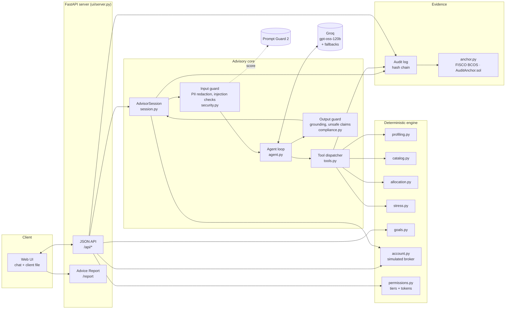
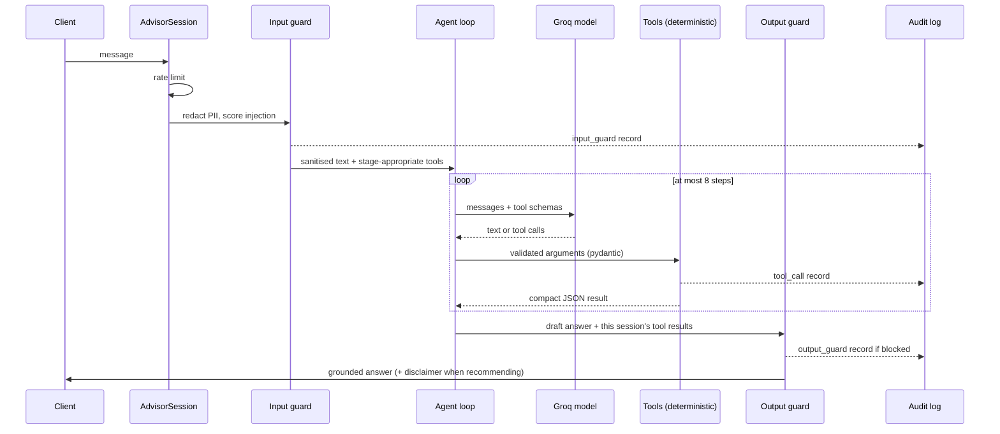

# Architecture

Lucid is an AI wealth advisor that runs a professional advisory workflow — fact-find, risk
profiling, product comparison, explainable asset allocation, stress testing and client-confirmed
execution — while keeping every financial number and every money-moving action outside the
language model.

## Design principle: the model talks, code decides

| Concern | Owned by | Why |
|---|---|---|
| Conversation, mapping free text to questionnaire options, explaining results | LLM (Groq) | Language is what models are good at |
| Risk class, weights, returns, volatility, fees, VaR, stress losses, goal probabilities | Deterministic Python, unit-tested | Reproducible, auditable, no hallucinated figures |
| Suitability (Cn ≤ Rn), liquidity, limits, cooling-off | Server-side code | Cannot be talked around |
| Placing orders | Human only, via one-time tokens | The model has no tool that can execute or confirm |
| Record of what happened | Hash-chained audit log, anchored on WeBank's FISCO BCOS consortium chain | Tamper-evident, independently verifiable |

## Components



## One chat turn



Key properties of the loop:

- **Stage-aware tools.** The model only sees tools valid for the current stage (no profile → fact-find
  and profiling tools; profile → allocation and comparison; allocation → stress and comparison).
- **Server-owned state.** The risk class, client facts and allocations live in `SessionState`. Tools
  read the investor class from the stored profile, never from model arguments, and the stress test
  takes an allocation id, never a portfolio passed by the model.
- **Robust to free-tier models.** Tool errors return `{"error", "hint"}` to the model instead of
  crashing; repeated failing calls are capped; on HTTP 429 from every model the client waits for the
  shortest `retry-after` and retries the chain; non-429 failures fall through to the next model.
- **Token budget.** Compact schemas, short system prompt, history trimmed to complete turns.
  Prompt and completion tokens and latency are logged per call.

## Data model

| Object | Where | Notes |
|---|---|---|
| `ClientFacts` | `session.py` | amount, horizon, max acceptable loss, age, borrowed money — collected in chat or in the form |
| `InvestorProfile` | `profiling.py` | class C1–C5, capacity and tolerance classes, reason codes, vulnerability flags, liquidity need, expiry (12 months) |
| `Product` | `data/products.json` | mock catalog with risk level R1–R5, expected return, volatility, fee, liquidity days, minimum, NAV |
| `Allocation` | `allocation.py` | holdings with weights, amounts and reason codes; portfolio return, volatility, fee, 95% VaR |
| `StressResult` | `stress.py` | scenario loss in % and money, breach of the client's own limit |
| `SimulatedOrder` | `account.py` | draft → executed, T+2 settlement, cooling-off for R4+ |
| Audit record | `audit.py` | timestamp, event, details, `prev_hash`, `hash` (SHA-256 over canonical JSON) |

## Permission tiers

| Tier | Capability | How it is reached |
|---|---|---|
| T0 `INFO` | Education and product facts | — |
| T1 `ADVISE` | Profiling, portfolios, comparison, stress tests, goal planning | Default for every session |
| T2 `PROPOSE` | Draft orders on the simulated account | — |
| T3 `EXECUTE` | Execute drafts with a one-time human token | Client signs the risk disclosure in the UI |

Execution needs a token issued to the human holding the confirm button (`/api/orders/tokens`).
Tokens are stored hashed, bound to the exact order summary, expire after five minutes and are
consumed on first use. The model's tool list contains no execute, confirm or token operation.
A kill switch (`WEALTH_ADVISOR_KILL_SWITCH`) caps every session at T1.

## Evidence chain

1. Every guard decision, model call (model, tokens, latency), tool call, order and report is appended
   to `logs/audit.jsonl`; each record includes the previous record's hash.
2. `verify_audit_log()` recomputes the chain; any edit, deletion or reordering breaks it.
3. The Advice Report's SHA-256 fingerprint is written into the chain.
4. `anchor.py` writes the chain head and record count to the `AuditAnchor` smart contract
   (`contracts/AuditAnchor.sol`) on a FISCO BCOS 3.x consortium chain — the open-source chain led by
   WeBank — through its Web3-compatible RPC. `verify_anchor()` decodes the call, checks the contract
   state and recomputes the local chain; any rewrite before the anchored block is detected.
   `scripts/fisco_chain.sh` starts a local 4-node chain; `ANCHOR_NETWORK=sepolia` switches to the
   public Ethereum testnet instead.

## Deployment

| Piece | Choice |
|---|---|
| Runtime | Python 3.12, `uv`; one command: `uv run wealth-advisor-ui` |
| LLM | Groq free tier through the OpenAI-compatible API; primary `openai/gpt-oss-120b`, fallbacks `qwen/qwen3.8-27b`, `openai/gpt-oss-20b`; injection classifier `meta-llama/llama-prompt-guard-2-86m` |
| Offline mode | `LLM_MODE=replay` serves recorded responses; the full test suite runs without a key |
| Secrets | `.env` only (git-ignored) |
| Data | 24 real Chinese public mutual funds from open East Money data (`scripts/build_cn_catalog.py`); historical markets from Kenneth R. French, FRED and World Bank; no real client data, no real broker |
| Blockchain | Local FISCO BCOS 3.17 consortium chain (4 nodes), `scripts/fisco_chain.sh start` |

## Repository map

```
src/wealth_advisor/
  session.py      AdvisorSession: state, turn pipeline, order path, snapshot for the UI
  agent.py        bounded tool-calling loop
  llm.py          Groq client: fallback chain, 429 handling, replay mode, usage logging
  tools.py        tool schemas and validated dispatcher
  prompts.py      advisor system prompt
  profiling.py    questionnaire and C1–C5 scoring
  catalog.py      product catalog, suitability filter, comparison
  allocation.py   portfolio construction
  stress.py       historical scenario stress tests
  goals.py        Monte Carlo goal planning
  compliance.py   suitability and pre-trade checks, output guard
  security.py     PII redaction, injection detection, rate limiting
  permissions.py  tiers and one-time confirmation tokens
  account.py      simulated brokerage account
  audit.py        hash-chained audit log
  anchor.py       audit anchoring on FISCO BCOS (or Sepolia) and verification
  rehearsal.py    Crash Rehearsal: 2007-2013 replay and revealed risk tolerance
  ui/             web server, static front end, Advice Report
evals/redteam/    attack suite, runner, report
evals/journeys/   client personas, live journey runner, report
tests/            unit, API, red-team regression tests
```
