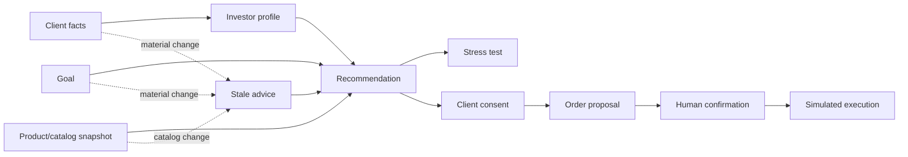

# Keel advisory ontology

Keel treats an advisory session as a versioned chain of evidence:

The ontology lives in `src/wealth_advisor/ontology.py`. It describes identity, version,
provenance and status; it does not calculate returns or portfolio weights. Calculations remain in
`profiling.py`, `catalog.py`, `allocation.py`, `stress.py` and `goals.py`.

## Entities

| Entity | Meaning | Version binding |
|---|---|---|
| `ClientFactsRecord` | Facts collected from the client in CNY context | Content hash of material facts |
| `InvestorProfile` | C1–C5 result, capacity, tolerance, flags and expiry | Profile hash + source facts version |
| `GoalRecord` | Target, horizon, monthly saving and inflation assumption | Goal content hash |
| `ProductSnapshot` | Product facts at a catalog/source date | Catalog hash and source/as-of fields |
| `Recommendation` | Allocation and reasons produced from the above inputs | Profile, goal, catalog and calculation versions |
| `ClientConsent` | Human acceptance of one exact recommendation | Recommendation hash + disclosure hash |
| `OrderProposal` | Proposed simulated order | Recommendation ID + order summary hash |
| `AuditReference` | Link to the append-only audit record | Audit record hash |

## Lifecycle rules

The server owns lifecycle transitions. The model can request a tool, but it cannot set a stage,
sign consent or execute an order.

- A profile is invalid after its expiry date or after material facts change.
- A recommendation becomes stale when profile, goal, client loss limit, catalog or calculation
  versions change.
- Stale recommendations cannot create drafts, issue confirmation tokens or execute orders.
- A consent is bound to one recommendation fingerprint. A token for another recommendation fails.
- A catalog update does not silently change an existing report; it creates a stale reason and requires
  a refresh.
- Every material change and transition is appended to the audit chain.

Material facts include amount, horizon, liquidity need, maximum loss, age, borrowed money, income
stability, emergency fund, invested share and experience.

## China-specific semantics

The default universe is CNY-denominated Chinese products. Deposits, large CDs, savings bonds and
mutual funds are separate product kinds. Deposit insurance is only displayed for eligible deposit
products; it is never inferred for a mutual fund. Product source and as-of information should be
shown when available, and stale market/rate data must be labelled.

The suitability model is **modelled on** Chinese investor-suitability principles. It is not a legal
certification and does not implement every regulatory workflow.

## Example invalidation path

1. A C3 client receives recommendation `recommendation-1` for a home goal.
2. The client changes the maximum acceptable loss from 20% to 5%.
3. The facts version changes and `recommendation-1` receives `CLIENT_FACTS_CHANGED`.
4. Draft creation returns a stale recommendation error.
5. The advisor refreshes the allocation, creating a new recommendation fingerprint.
6. The human reviews and signs consent for the new fingerprint before simulated execution.
